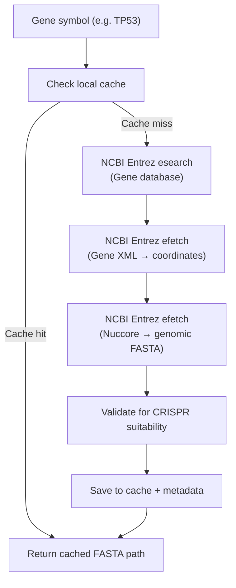

# Step 2 — Dynamic Gene Sequence Retrieval via NCBI

## Summary

Replaced the local-only gene resolution with a real NCBI Entrez-backed genomic sequence provider. Running `python main.py --gene TP53` now dynamically resolves the gene through NCBI, retrieves the correct human genomic DNA from the GRCh38 reference assembly, caches it locally, and feeds it into the existing gRNA pipeline — all without modifying any biological algorithms.

---

## Final Report

| # | Item | Value |
|---|------|-------|
| 1 | **Files created** | [`src/ncbi_sequence_provider.py`](file:///c:/Users/daksh/Documents/CRISPR-GuideRNA-Optimization/src/ncbi_sequence_provider.py) |
| 2 | **Files modified** | [`src/gene_sequence_provider.py`](file:///c:/Users/daksh/Documents/CRISPR-GuideRNA-Optimization/src/gene_sequence_provider.py), [`gene_sequence_provider.py`](file:///c:/Users/daksh/Documents/CRISPR-GuideRNA-Optimization/gene_sequence_provider.py) (root re-export), [`main.py`](file:///c:/Users/daksh/Documents/CRISPR-GuideRNA-Optimization/main.py) |
| 3 | **NCBI endpoint/tools used** | Entrez **esearch** (Gene DB), Entrez **efetch** (Gene DB → XML), Entrez **efetch** (Nuccore → FASTA) |
| 4 | **Accession selected for TP53** | **NC_000017.11** |
| 5 | **Assembly/reference used** | **GRCh38** (Genome Reference Consortium Human Build 38) |
| 6 | **Sequence length** | **23,070 bp** (gene body 19,069 bp + 2,000 bp flanking each side) |
| 7 | **FASTA cache location** | [`data/reference_sequences/TP53_NC_000017_11.fasta`](file:///c:/Users/daksh/Documents/CRISPR-GuideRNA-Optimization/data/reference_sequences/TP53_NC_000017_11.fasta) |
| 8 | **Number of gRNA candidates** | **3,554** (1,825 on + strand, 1,729 on − strand) |
| 9 | **Exact command used** | `python main.py --gene TP53` |
| 10 | **Biological assumptions** | See below |

---

## Biological Assumptions

1. **Genomic DNA, not CDS/mRNA**: CRISPR guides target genomic DNA (including introns, UTRs, and regulatory regions). The provider retrieves the full genomic region from the chromosome reference, not a transcript.

2. **Flanking regions**: 2,000 bp upstream and downstream of the gene body are included to capture promoter-proximal PAM sites and downstream regulatory elements.

3. **Strand orientation**: TP53 is on the **minus strand** of chromosome 17. The sequence is fetched in the gene's native strand orientation (reverse complement of the reference plus strand), matching the existing `data/gene.fna` convention.

4. **Human only**: Currently restricted to *Homo sapiens* (NCBI Taxonomy ID 9606).

5. **Reference assembly**: Uses GRCh38 (NC_ accessions), the current standard reference.

6. **Gene coordinates**: chr17:7668421-7687490 (NCBI Gene ID: 7157), retrieved window: chr17:7666421-7689490.

---

## Architecture

```
SequenceProvider (ABC)
├── LocalSequenceProvider    — resolves from local file registry (preserved)
└── NCBISequenceProvider     — resolves via NCBI Entrez (new default)
```

The NCBI provider follows a 3-step Entrez workflow:



---

## Files Not Modified (biological algorithms preserved)

- ❌ `src/guide_generation.py` — PAM detection, guide extraction, pipeline
- ❌ `src/feature_extraction.py` — GC content, thermodynamics, etc.
- ❌ `src/optimization.py` — weighted scoring
- ❌ `src/convex_optimization.py` — convex optimization
- ❌ `src/visualization.py` — plots
- ❌ `src/generate_dashboard.py` — dashboard

---

## Validation Results

| Check | Result |
|-------|--------|
| TP53 resolved through NCBI | ✅ Gene ID 7157 found via esearch |
| Accession/reference printed | ✅ NC_000017.11, GRCh38, chr17:7668421-7687490 |
| Sequence saved as FASTA | ✅ `data/reference_sequences/TP53_NC_000017_11.fasta` (23,070 bp) |
| pam_guide_module receives FASTA | ✅ Path passed to `run_pipeline()` |
| PAM scanning on both strands | ✅ + strand: 1,825 guides, − strand: 1,729 guides |
| 20-nt guides generated | ✅ All guides are exactly 20 nt |
| guide_candidates.csv generated | ✅ 3,554 candidates saved |
| No feature/optimization code modified | ✅ Confirmed via git status |
| Source accession recorded | ✅ Full metadata in `.metadata.json` |
| Cache works on second run | ✅ No NCBI calls on re-run |
| `--fasta` flag still works | ✅ Direct FASTA path bypasses NCBI |

---

## Cached Metadata

The metadata JSON at [`TP53_NC_000017_11.metadata.json`](file:///c:/Users/daksh/Documents/CRISPR-GuideRNA-Optimization/data/reference_sequences/TP53_NC_000017_11.metadata.json) records full provenance:

```json
{
  "gene_symbol": "TP53",
  "organism": "Homo sapiens",
  "ncbi_gene_id": "7157",
  "chromosome": "17",
  "genomic_accession": "NC_000017.11",
  "assembly": "GRCh38",
  "sequence_type": "genomic_DNA",
  "strand": "minus",
  "gene_start": 7668421,
  "gene_stop": 7687490,
  "retrieved_start": 7666421,
  "retrieved_stop": 7689490,
  "sequence_length": 23070,
  "retrieval_timestamp": "2026-08-29T12:32:52.915293+00:00"
}
```

---

## Error Handling

| Scenario | Behavior |
|----------|----------|
| Gene not found in NCBI | `NCBIResolutionError` with clear message listing the query used |
| NCBI unreachable | `NCBINetworkError` with connection details |
| Multiple gene records | Explicit selection rule: exact symbol match → lowest Gene ID; all candidates logged |
| Sequence too short (<23 bp) | `NCBISequenceUnsuitableError` explaining minimum for CRISPR |
| Protein instead of DNA | `NCBISequenceUnsuitableError` explaining genomic DNA required |
| >50% ambiguous bases (N) | `NCBISequenceUnsuitableError` explaining poor assembly |

---

> [!NOTE]
> No new pip dependencies were added. The implementation uses Biopython's `Bio.Entrez` module (already in `requirements.txt`) and Python standard library (`xml.etree`, `json`, `dataclasses`).
